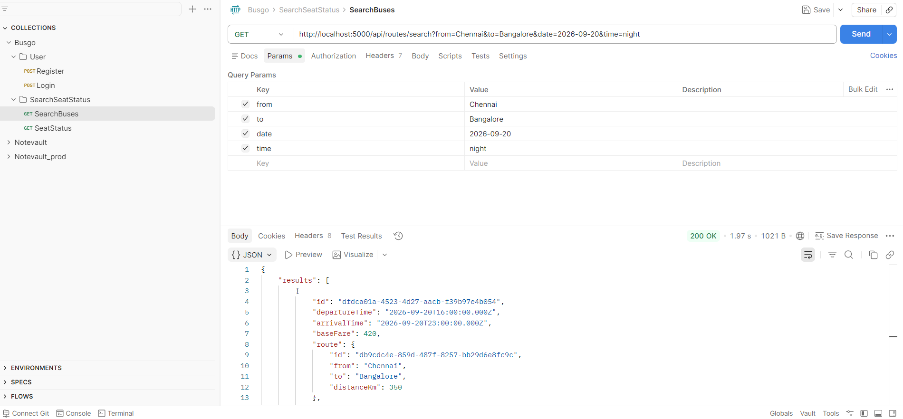
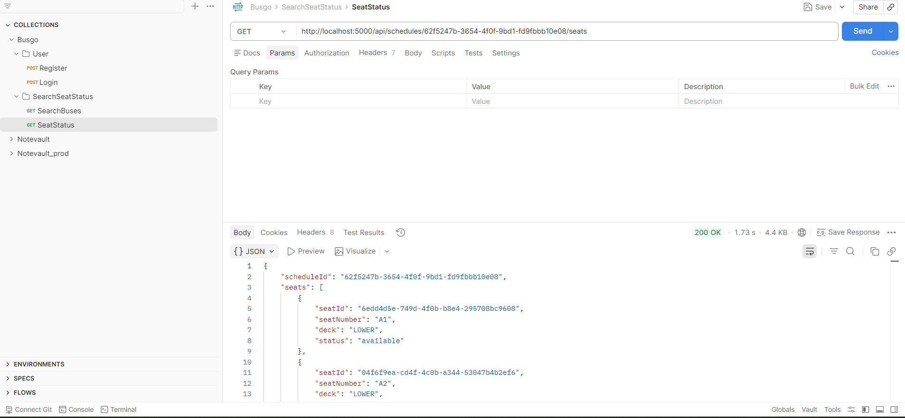
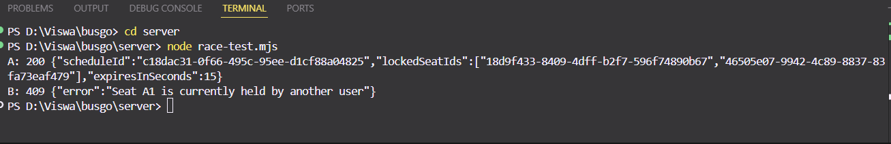

# BusGo

A full-stack bus ticket booking platform with real-time seat selection, Razorpay payments, and PDF ticket generation.

## Tech Stack

**Client:** React, TypeScript, Vite, Tailwind CSS, Zustand, TanStack Query
**Server:** Node.js, Express, TypeScript, Prisma ORM
**Database:** PostgreSQL (Neon, serverless)
**Cache / Seat Locks:** Redis (Upstash, via ioredis)
**Infra (planned):** Vercel (client), Render (server)

## Project Structure
busgo/
├── client/       React + Vite + Tailwind frontend
├── server/       Express + TypeScript + Prisma backend
├── screenshots/  Proof-of-work screenshots
└── README.md

## API Endpoints

| Method | Route | Auth | Description |
|---|---|---|---|
| POST | `/api/auth/register` | Public | Create a new user account, returns JWT |
| POST | `/api/auth/login` | Public | Authenticate existing user, returns JWT |
| GET | `/api/routes/search` | Public | Search schedules by route and date, with optional time-of-day filter |
| GET | `/api/schedules/:id/seats` | Optional | Live seat map for a schedule (available / booked / locked) |
| POST | `/api/seats/lock` | Required | Temporarily hold seats for 10 minutes |
| POST | `/api/seats/unlock` | Required | Release seats you are holding |

### Search

`GET /api/routes/search?from=Chennai&to=Bangalore&date=2026-09-20&time=night`

| Param | Required | Description |
|---|---|---|
| `from` | Yes | Origin city (case-insensitive) |
| `to` | Yes | Destination city (case-insensitive) |
| `date` | Yes | Travel date in `YYYY-MM-DD` format |
| `time` | No | `morning` (5–11), `afternoon` (12–17), or `night` (18–23) |

### Seat status

`GET /api/schedules/:id/seats` returns every seat on the bus with a status of `available`, `booked`, or `locked`.

- **booked** — an active (non-cancelled) booking exists for that seat on that schedule, read from PostgreSQL
- **locked** — a temporary hold exists in Redis (`seat:{scheduleId}:{seatId}`), set to expire automatically
- **lockedByYou** — included on locked seats; `true` only when a valid JWT is sent and it belongs to the user holding the lock

The route is public, but sending a token lets the response tell you which locks are yours.

### Seat locking

`POST /api/seats/lock` and `POST /api/seats/unlock` both take the same body and require a Bearer token:

```json
{
  "scheduleId": "uuid-of-the-schedule",
  "seatIds": ["uuid-of-seat-1", "uuid-of-seat-2"]
}
```

**Lock responses**

| Status | Meaning |
|---|---|
| `200` | All seats locked; returns `lockedSeatIds` and `expiresInSeconds: 600` |
| `400` | Invalid IDs, more than 6 seats, seats from a different bus, or the bus has already departed |
| `404` | Schedule not found |
| `409` | A seat is already booked, or currently held by another user |

**How it works**

- Each lock is a single atomic Redis command: `SET seat:{scheduleId}:{seatId} {userId} EX 600 NX`. `NX` means "only if the key doesn't exist", so when two users race for the same seat, exactly one succeeds and the other gets a 409.
- The 10-minute expiry is part of the same command, so abandoned locks clear themselves with no cleanup job.
- Locking several seats is all-or-nothing. If any seat is taken, the seats already grabbed in that request are released.
- Locking a seat you already hold refreshes its 10-minute timer instead of failing.
- Unlock releases only seats held by the caller, using a Lua script so the ownership check and delete happen atomically. Seats held by someone else are returned in `skippedSeatIds` and left untouched.

**Why Redis TTL instead of a `locked_at` column in Postgres:** the lock is checked, written and timed in one atomic step, so there is no read-then-write race, and Redis expires stale locks itself instead of needing a cron job to sweep them.

## Setup

1. Clone the repo
2. `cd server && npm install`
3. `cd client && npm install`
4. Copy `server/.env.example` to `server/.env` and fill in:
   - `DATABASE_URL` — your Neon Postgres connection string
   - `JWT_SECRET` — any long random string (generate with `node -e "console.log(require('crypto').randomBytes(32).toString('hex'))"`)
   - `REDIS_URL` — your Upstash Redis TLS connection string (starts with `rediss://`)
   - `PORT` — defaults to 5000
5. `cd server && npx prisma migrate dev` — creates all 7 tables on Neon
6. `npx prisma db seed` — populates 3 routes, 6 buses, 240 seats, 42 schedules
7. Run both dev servers separately: `npm run dev` in `client/` and `npm run dev` in `server/`

## Demo Data

Running the seed script creates realistic sample data:
- **3 routes** — Chennai↔Bangalore, Bangalore↔Hyderabad, Hyderabad↔Chennai
- **6 buses** — one SLEEPER and one AC_SLEEPER per route
- **240 seats** — 40 per bus (A1–H5 grid, split across lower/upper deck)
- **42 schedules** — 7 days of departures per bus, with distance-based fares

## Progress

- [x] **Day 1** — Monorepo scaffold, Tailwind client, Express + tsx server, Prisma schema (7 models), Neon DB connected and migrated
- [x] **Day 2** — Auth API (register/login) with bcrypt + JWT, auth middleware, centralized error handling (Zod + Prisma errors), Prisma seed script with realistic demo data, tested end-to-end in Postman
- [x] **Day 3** — Search API with date and time-of-day filters, seat status API merging PostgreSQL bookings with Redis locks, optional-auth middleware, Upstash Redis connected
- [x] **Day 4** — Redis seat locking with atomic `SET NX EX`, lock/unlock APIs with ownership checks (Lua compare-and-delete), all-or-nothing multi-seat locking, concurrency verified with two simultaneous requests (one `200`, one `409`)
 
## Screenshots

### Database (Prisma Studio)


### Auth API (Postman)






### Seat Locking

**Concurrent lock test — one 200, one 409**


