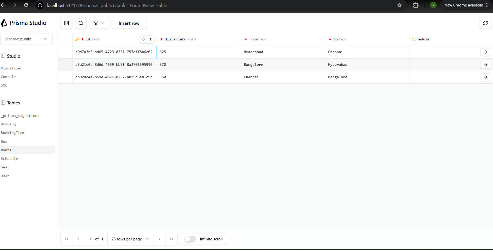
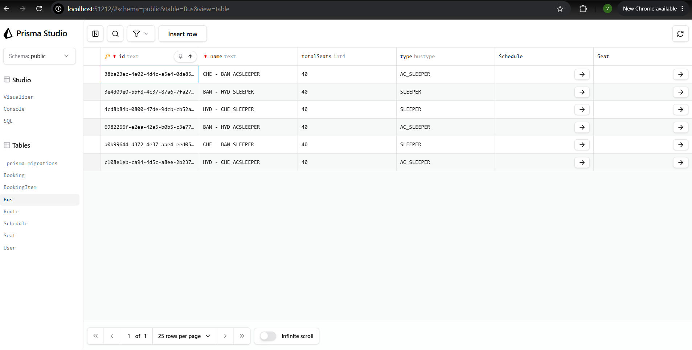
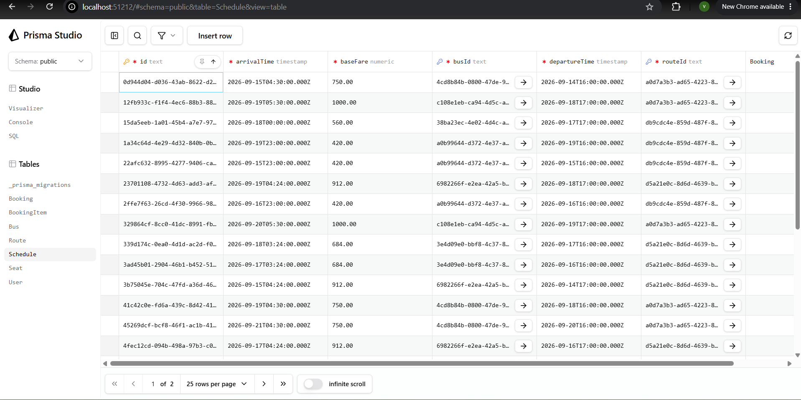
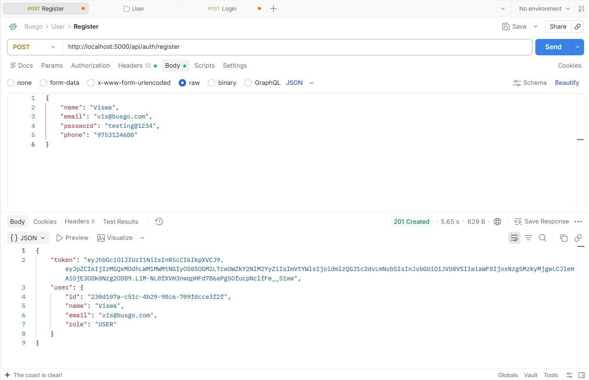
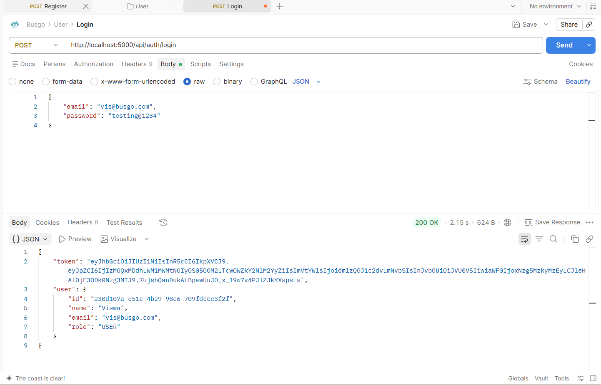

BusGo

A full-stack bus ticket booking platform with real-time seat selection, Razorpay payments, and PDF ticket generation.

Tech Stack

Client: React, TypeScript, Vite, Tailwind CSS, Zustand, TanStack Query Server: Node.js, Express, TypeScript, Prisma ORM Database: PostgreSQL (Neon, serverless) Infra (planned): Redis (Upstash), Vercel (client), Render (server)

Project Structure
busgo/
├── client/       React + Vite + Tailwind frontend
├── server/       Express + TypeScript + Prisma backend
├── screenshots/  Proof-of-work screenshots
└── README.md

API Endpoints
Method	Route	Description
POST	/api/auth/register	Create a new user account, returns JWT
POST	/api/auth/login	Authenticate existing user, returns JWT

Setup
Clone the repo
cd server && npm install
cd client && npm install
Copy server/.env.example to server/.env and fill in:
DATABASE_URL — your Neon Postgres connection string
JWT_SECRET — any long random string (generate with node -e "console.log(require('crypto').randomBytes(32).toString('hex'))")
PORT — defaults to 5000
cd server && npx prisma migrate dev — creates all 7 tables on Neon
npx prisma db seed — populates 3 routes, 6 buses, 240 seats, 42 schedules
Run both dev servers separately: npm run dev in client/ and npm run dev in server/

Demo Data

Running the seed script creates realistic sample data:

3 routes — Chennai↔Bangalore, Bangalore↔Hyderabad, Hyderabad↔Chennai
6 buses — one SLEEPER and one AC_SLEEPER per route
240 seats — 40 per bus (A1–H5 grid, split across lower/upper deck)
42 schedules — 7 days of departures per bus, with distance-based fares

Progress
 Day 1 — Monorepo scaffold, Tailwind client, Express + tsx server, Prisma schema (7 models), Neon DB connected and migrated
 Day 2 — Auth API (register/login) with bcrypt + JWT, auth middleware, centralized error handling (Zod + Prisma errors), Prisma seed script with realistic demo data, tested end-to-end in Postman
 
Screenshots

Database (Prisma Studio)

Auth API (Postman)

